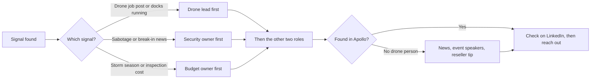

# FlytBase Problem 1: Finding the Right Grid Companies and the Right Person Inside Them

  

Girisha Anamala · October 2026

  

## Short answer

  

FlytBase's buyer has no fixed title, so I looked for a sign that a company already flies drones or is about to. I worked out which pain that sign points to, and reach the three people who feel it:

  

1. &#32;who runs the drones

2. who pays for site inspections&#32;

3. whoever owns site security.

  

I'd start with grid operators that resemble Statnett, an existing FlytBase customer, and go to Europe before the US. I tested my search on three real grid operators. The drone work sat under **Aviation** at Statnett, under **Innovation** at Elia, and in no visible title at TenneT.

  

&#91;image: image.png\]

  

*Three grid operators, three different departments running drones.*

  

I followed a seven-step outbound framework: research, ICP and market sizing, offer, messaging, scripts, sending setup, and list building. I used AI tools to research and to argue with my ideas. The tests and decisions are mine.

  

## 1. Where I changed my mind

  

| What I first thought | What I found | What I do now |

| --- | --- | --- |

| Find the right job title | The title in FlytBase's own Statnett case study was already out of date | Search by signal and role, then confirm the person |

| Start in the US, the biggest market | Dominion Energy just added 100 docked drones with Skydio, and new US rules block new foreign drone models | Start in Europe, Asia, Latin America and the Middle East |

| The drone team lives in one department | Aviation at Statnett, Innovation at Elia, no visible title at TenneT | Search a family of words, and use other sources when the database is empty |

| Paste one keyword list into Apollo | Industry words like "substation" matched construction engineers | Job words go in the people filter, industry words in the company filter |

  

## 2. Starting from first principles

  

Before choosing tools, I asked why a grid company would pay for drone software at all. Someone has to go and look at remote equipment: a substation after an alarm, a power line after a storm. Sending a person is slow and costly. Shell's offshore drone crews cost up to about $20,000 per trip ([JPT](https://jpt.spe.org/jpt-exclusive-shell-advances-drone-operations-in-the-us-gulf)).

  

So the buyer is whoever pays for that look today, and a grid company has three budgets for it:

  

| The look | Who pays today | What they'd want |

| --- | --- | --- |

| Routine inspection of lines and substations | Operations or asset management | Fewer crew trips for the same coverage |

| Checking an alarm at a remote site | Security | Eyes on site before a crew drives out |

| Running the drone program | A drone, aviation or innovation lead | Many docks run from one place, any brand |

  

The department, and so the title, depends on which look a company automated first. So I follow the pain first and the title second.

  

## 3. Which companies and signals

  

### What FlytBase sells, in short

  

| Topic | Finding | Source |

| --- | --- | --- |

| Product | Software that flies docked drones on schedule and runs many sites from one screen. Customers buy the docks separately, mostly DJI | [FlytBase platform](https://flytbase.com/platform) |

| Price | $999 a year for Pro; about $4,000–4,500 per dock per year for Enterprise at reseller list prices | [FlytBase pricing](https://flytbase.com/pricing), [Maverick Drone](https://www.maverickdrone.com/products/flytbase-enterprise-for-dock-3) |

| Market | Drone-in-a-box was about $1.4–1.5B in 2025, growing about 20% a year | [Fortune Business Insights](https://www.fortunebusinessinsights.com/drone-in-a-box-market-108470), [Straits Research](https://straitsresearch.com/report/drone-in-a-box-market) |

| Main alternative | DJI's FlightHub 2, $0–3,280 per device per year, DJI hardware only | [Advexure](https://advexure.com/products/dji-flighthub-2) |

  

The software only helps once a company owns docks, so I target companies already flying drones and sell the move from a few docks to many. FlytBase's edge over DJI's own software grows with the number of sites, brands and camera links.

  

I scored 27 segments from 1 to 10 on size, fit, buying speed, deal size and how much explaining they need, then estimated 24-month revenue for the top ten. The revenue figures rest on my guesses for win rates and deal size, so I only use them to rank segments.

  

&#91;embedded content: My estimates from the TAM map · top 10 segments, 24 months\]

  

### Where I'd start

  

**Anchor: Statnett.** Norway's national grid operator runs about 11,000 km of lines and 150 substations, and did the country's first fully remote drone inspection with FlytBase ([FlytBase](https://flytbase.com/blog/statnett-deploys-first-remote-drone-inspection-with-flytbase)). I look for companies that resemble it.

  

| Order | Segment | Why | FlytBase proof |

| --- | --- | --- | --- |

| 1 | Grid operators | Hundreds of unmanned sites, and the drone owner can be found | Statnett, Xcel Energy |

| 1b | Solar owners, alongside grid | Faster to buy; many grid companies own solar too | EnBW: up to 4× more inspections at the same budget |

| 2 | Oil and gas | Biggest savings per site, fewer buyers | Shell Rotterdam, Shell offshore |

| Side lane | Security companies, as resellers | Fast to buy, each covers many client sites | Titan Protection: about 60% cheaper than guards ([Commercial UAV News](https://www.commercialuavnews.com/titan-protection-s-ryan-smith-talks-drone-based-security-solutions-at-nestgen-2025)) |

  

Europe comes before the US. Dominion Energy just put in 100 docked drones with Skydio ([DroneXL](https://dronexl.co/2026/10/16/skydio-dominion-energy-100-docked-drones-linemen-pilots/)), and US rules now block new foreign drone models ([DroneDeploy](https://www.dronedeploy.com/blog/foreign-drones-and-the-fcc-covered-list-a-fact-based-guide-for-compliance-teams)). Most FlytBase sites run on DJI docks.

  

The market is small. ENTSO-E lists about 40 transmission operators in Europe ([ENTSO-E](https://www.entsoe.eu/about/)), and my top ten segments add up to roughly 4,200 accounts. So I'd research every account instead of sending volume.

  

### Signals that a company is worth contacting now

  

| Signal | Where I'd find it | What it points to |

| --- | --- | --- |

| Hiring for drone, UAS or aviation roles | Job boards, career pages | A program that's starting or growing |

| Substation sabotage or break-in | News alerts | Security pain right now |

| Staff speaking at drone or energy events | Event speaker lists | The name of the program owner |

| Docks already running | Case studies, competitor announcements | Ready to scale |

  

&#91;image: image.png\] *named customers cluster in energy** **a**n**d oi**l**, which is why I anchored there.*

  

## 4. Finding the person

  

### The method

  

Three roles instead of one title:

  

| Role | Cares about | In a college lab buying laptops |

| --- | --- | --- |

| Drone lead | Running and growing the drone program | The student who wants the laptops |

| Budget owner | Cost, outages, crew time | The head of department who approves the money |

| Security owner | Break-ins, sabotage | The admin who checks it's safe |

  

The signal decides who I contact first:

  



  

In Apollo, job words go in the people filter and industry words in the company filter, and only people who match both count, like a SQL join. My first try mixed them in one list, and words like "substation" pulled in construction engineers.

  

### Test 1: Statnett, Norway (I knew the answer)

  

**My first search missed the one person I knew existed.**

  

FlytBase's case study names Statnett's drone lead as a "Senior UAS Program Manager". I used Statnett as a unit test: if the search can't find someone I know is there, I can't trust it elsewhere.

  

| Search | Result |

| --- | --- |

| "UAS" and "drone" only | 0 people |

| Re-run with "aviation" added to the keyword list | 12 people, including a Project Engineer – Drones and a VP Technology Development Substation |

  

Grid companies used helicopters for line checks long before drones, so drones landed in the aviation team.

  

| Role | Name | Title |

| --- | --- | --- |

| Drone lead | Espen Blomlie | Head of Aviation and Drones |

| Budget owner | Peer Ostli | EVP Grid Operations |

| Security owner | (first name only in Apollo) | Corporate Manager Security & Preparedness |

  

&#91;image: image.png\]

  

### Test 2: Elia, Belgium (I didn't know the answer)

  

35 people with the updated keywords.

  

| Role | Name | Title |

| --- | --- | --- |

| Drone lead (likely) | Jeremy Abraham | Head of Innovation Operations |

| Budget owner | Kristof Geens | Head of Real-Time Grid Operations & Operational Expertise |

| Security owner | Terry Suvee | Physical Security System & Technology |

  

Elia runs its drone-in-a-box work as an innovation project ([Elia](https://innovation.eliagroup.eu/en/projects/revolutionizing-overhead-line-incident-response-introducing-drone-in-a-box)), so the innovation head is the likely owner; I'd confirm on LinkedIn first. A certified drone operator also showed up, and about 15 results were construction engineers or CRM managers.

  

&#91;image: image.png\]

  

*Here the drone work sits under Innovation, with a certified drone operator on the team.*

  

### Test 3: TenneT, Netherlands (I didn't know the answer)

  

52 people, and nobody with "drone" or "UAS" in their title.

  

| Role | Name | Title |

| --- | --- | --- |

| Drone lead (best guess) | Thijs Pruijssers | Program Lead Digitalization, Innovation & Technology, Grid Field Operations |

| Budget owner | Lieke Korte | Lead Operations & Maintenance |

| Security owner (to check) | Tom Wissink | Security Specialist |

  

Several titles were in Dutch, and TenneT calls its field department "Grid Field Operations", a phrase no generic keyword list would contain.

  

*No drone title at all. The closest is an innovation program lead in Grid Field Operations.*

  

### What three companies taught me

  

| Finding | What I changed |

| --- | --- |

| Each company puts drones in a different department | Search a family of words: aviation, drones, UAS, unmanned, innovation, field operations |

| Titles in Norwegian and Dutch | Add local-language terms per country |

| The database can come up empty | Switch to news, event speakers and reseller tips |

  

## 5. Offer and messages

  

The framework treats the offer as the strongest lever. Give the buyer something useful and ask for a small yes before any meeting.

  

| Who | What I'd offer first | Why it's a small yes |

| --- | --- | --- |

| Drone lead | A write-up of how Statnett and Shell run many docks from one control room | They already care; it shows the next step |

| Budget owner | A rough count of crew trips their sites could avoid | It's about their own sites and numbers |

| Security owner | How other grid operators send a drone to an alarm before a crew | Answers what they ask after every incident |

  

Messages follow the framework's rules: under 60 words, open with their signal, end with a soft question, name a peer from the same industry, keep subject lines to one to three lowercase words, and write to two or three people per company.

  

**Drone lead, after a drone job post**

  

> Subject: running more docks

>

> Hi {first\_name}, saw {company} is hiring a drone operator. Statnett went through the same stage and now runs its docks across sites from one operations center. Want the two-page write-up of how they set it up?

  

**Security owner, after a substation incident**

  

> Subject: substation alarms

>

> Hi {first\_name}, when an alarm goes off at a remote substation, how long until someone sees what's happening? A few grid operators now send a docked drone first, before a crew drives out. Happy to share how it works.

  

## 6. What I don't know

  

| Question for FlytBase | What the answer would change |

| --- | --- |

| In recent deals, which title signed, and who replied first? | Which of the three roles I lead with |

| How long does a deal take, first contact to contract? | Every timeline in this doc |

| How many customers owned docks before buying FlytBase? | Whether "already flying drones" is the right filter |

| What share run non-DJI hardware? | Whether the US is reachable now or later |

| Which resellers know who bought docks recently? | A reseller tip beats any cold list |

| Which deployments can be named in outreach? | Which proof points I can use |

  

## 7. Assumptions and realistic numbers

  

My assumptions: companies already flying drones are easier to win; most grid companies have the three roles; FlytBase's self-reported savings are directional; DJI setups still sell outside the US; Enterprise costs about $4,000 per dock per year.

  

What one person could do in the first 90 days:

  

| Step | Number |

| --- | --- |

| Grid companies researched properly | 50 |

| People per company | About 3 |

| Contacts | About 150 |

| Reachable after email checks | About 100–120 |

| Replies, if each message matches a real signal | Roughly 5–10 |

| Real conversations | Roughly 2–4 |

| Signed deals | Probably none yet; grid companies take 6–18 months to buy |

  

The framework's benchmarks for hard enterprise markets are lower, nearer one interested reply per several hundred contacts. My estimate assumes the research makes each message relevant, which I haven't tested.

  

In the first quarter, the main result is a tested map of who owns drones at each grid company. Revenue comes later, from expansion. A utility moving from 5 docks to 100 pays FlytBase 20 times more.

  

| Claim | Status | Evidence |

| --- | --- | --- |

| Energy is FlytBase's strongest segment | Proven | Named case studies |

| Drone owners sit in different departments | Proven | Aviation, Innovation, unclear across three tests |

| Titles go stale | Proven | Statnett case study vs Apollo today |

| The US is harder right now | Partly | Dominion chose Skydio; US rules on foreign drones |

| A signal makes a reply more likely | Assumed | Not tested |

| The 90-day numbers | Assumed | My estimates |

  

## 8. My first 30 days if I joined

  

| Week | What I'd do |

| --- | --- |

| 1 | Pull real deal data: who signed, who replied, how long it took, which hardware |

| 2 | Build the first 50 grid accounts, each with a signal and three roles |

| 3 | Send the first messages; ask resellers which companies bought docks recently |

| 4 | Set up alerts for drone job posts, sabotage news and tenders; review replies and fix the keyword map |

  

## Appendix

  

### The whole strategy on one page

  

```mermaid

mindmap

  root((FlytBase outbound))

    Companies

      Grid operators first

      Solar alongside

      Oil and gas second

      Security firms as resellers

      Europe before US

    Signals

      Drone job posts

      Sabotage news

      Event speakers

      Docks already running

      Tenders

    Pains

      Paying crews to look

      Exposed fence line

      Stuck at pilot stage

      Downtime after storms

    People

      Drone lead

      Budget owner

      Security owner

    Sources

      ENTSO-E list

      Apollo

      News and events

      Reseller tips

```

  

### Full working documents

  

| Document | What's in it | Link |

| --- | --- | --- |

| Research report | FlytBase's products, pricing, competitors, rules by region, 39 named customers | 📎 [\[link\]](https://drive.google.com/file/d/1r5NWLbDAisQaSubu7Fs_78oTIu_VnRl5/view?usp=sharing) |

| Market map | 27 segments scored, top 10 sized, buyer titles per segment | 📎 [\[ link\]](https://drive.google.com/file/d/1djHmAlgm3NnO5LtOWfwS0R-UGoEoTk5i/view?usp=sharing) |

| Personas | 12 buyer profiles across four segments, five pain groups, ranking | 📎 [\[ link\]](https://drive.google.com/file/d/1OtpSiszjEAo4gl38OPewrtM1-S5CQBp6/view?usp=sharing) |

| Lead sourcing | 20 data sources scored on cost, accuracy and effort | 📎 [\[ link\]](https://drive.google.com/file/d/1rAcjPXrn-0pggqxH3oHXAkhRfGIJnVFa/view?usp=sharing) |

| Key data tables | Segment numbers, test results side by side, proof points, prices | 📎 [\[ link\]](https://drive.google.com/file/d/1djHmAlgm3NnO5LtOWfwS0R-UGoEoTk5i/view?usp=sharing) |